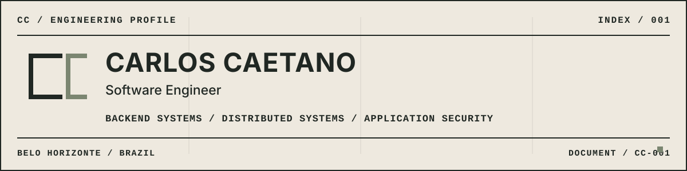

<picture>
  <source media="(prefers-color-scheme: dark)" srcset="./assets/hero-dark.svg">
  <source media="(prefers-color-scheme: light)" srcset="./assets/hero-light.svg">
  
</picture>

## 01 / ABOUT

I'm a software engineer at **ATTRUS**, with professional experience in payments and backend development. I primarily work with **Elixir, Phoenix, and PostgreSQL**, building services where reliable processing and clear failure handling matter.

My technical interests center on distributed systems reliability, backend architecture, secure API design, and applied AI for cybersecurity.

---

## 02 / SELECTED WORK

### Tidewake

`WEBHOOK DELIVERY / ELIXIR / PHOENIX`

A webhook delivery service designed around durable ingestion and recoverable background work.

- Creates events, delivery records, and initial Oban jobs in one database transaction.
- Signs exact payload bytes with HMAC-SHA256 and records each delivery attempt.
- Recovers stale work and rejects unsafe resolved destinations before delivery.

### Ironhold

`WEBHOOK RECEIVER / ELIXIR / SECURITY`

A companion receiver that verifies webhook authenticity before accepting and persisting an event.

- Verifies HMAC-SHA256 signatures against the exact raw request body within a bounded timestamp window.
- Checks event identity across headers and payload before accepting the request.
- Stores accepted events under a unique event ID with explicit duplicate and validation responses.

The source repositories are currently private. Both projects are early-stage engineering studies; retry policies, broader replay controls, secret rotation, and production operations remain roadmap work.

---

## 03 / TOOLKIT

`CORE` 
Elixir / Erlang/OTP / Phoenix / PostgreSQL / Oban

`SYSTEMS & DELIVERY` 
Docker / RabbitMQ / GitHub Actions / Linux / AWS

`PRODUCT DEVELOPMENT` 
TypeScript / React / Vue

---

## 04 / CONTACT

[GitHub](https://github.com/Carlos-ccaetano) / [LinkedIn](https://www.linkedin.com/in/carlos-caetano)
