<picture>
  <source media="(prefers-color-scheme: dark)" srcset="./assets/banner.svg">
  <source media="(prefers-color-scheme: light)" srcset="./assets/banner-light.svg">
  
</picture>

# Carlos Caetano

Backend developer working with Elixir at **ATTRUS**, in fintech
and building toward application security.

[](https://github.com/Carlos-ccaetano/Carlos-ccaetano/actions/workflows/ci.yml) [](./LICENSE)

```text
  CARLOS CAETANO
  Backend developer (Elixir) @ ATTRUS
  fintech · building toward AppSec

  $ whoami
    I build backend systems with Elixir
    at ATTRUS.
    I work in fintech and build toward
    AppSec.

  $ ls projects/
    Tidewake/
      durable, signed webhook delivery
    Ironhold/
      webhook verification and intake

  $ cat stack.txt
    elixir phoenix ecto postgresql
    aws python java

  $ contact
    github.com/Carlos-ccaetano
```

[Tidewake](https://github.com/Carlos-ccaetano/Tidewake) ·
[Ironhold](https://github.com/Carlos-ccaetano/Ironhold)

## License

Released under the [MIT License](./LICENSE).
