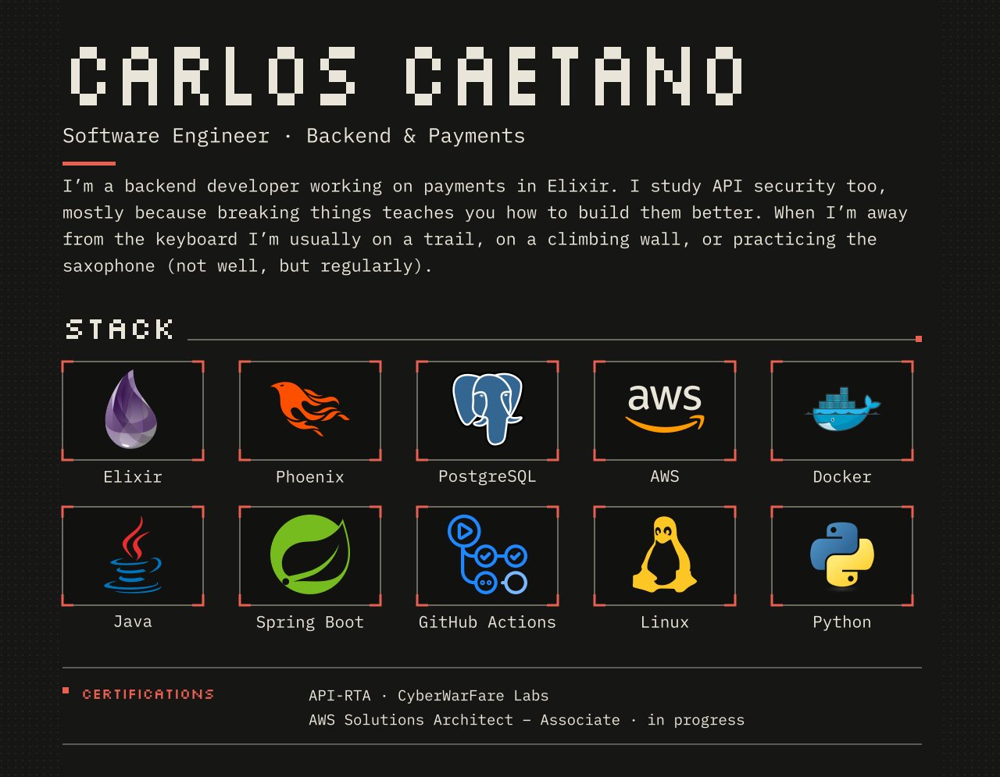

<picture>
  <source media="(max-width: 600px)" srcset="assets/hero-mobile.svg">
  
</picture>

Read as text

**CARLOS CAETANO**

Software Engineer · Backend & Payments

I’m a backend developer working on payments in Elixir. I study API security too, mostly because breaking things teaches you how to build them better. When I’m away from the keyboard I’m usually on a trail, on a climbing wall, or practicing the saxophone (not well, but regularly).

**Stack:** Elixir, Phoenix, PostgreSQL, AWS, Docker, Java, Spring Boot, GitHub Actions, Linux, Python

**Certifications:** API-RTA · CyberWarFare Labs; AWS Solutions Architect – Associate · in progress

