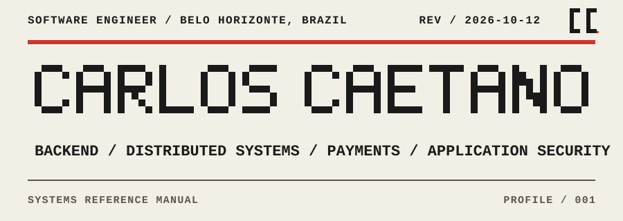
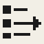
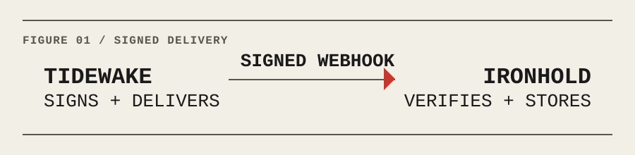
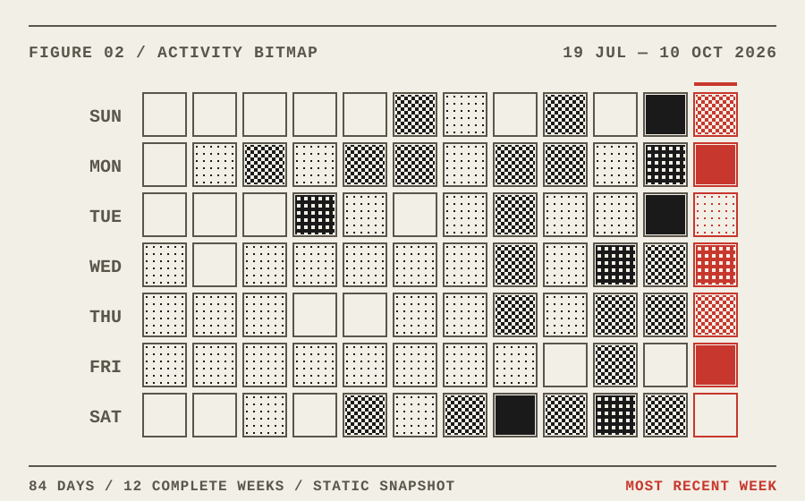
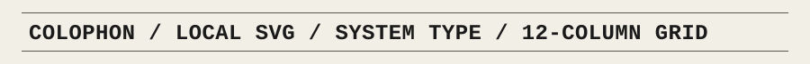

<picture>
  <source media="(prefers-color-scheme: dark)" srcset="./assets/hero-manual-dark.svg">
  <source media="(prefers-color-scheme: light)" srcset="./assets/hero-manual-light.svg">
  
</picture>

# Carlos Caetano

**Software Engineer** · Belo Horizonte, Brazil<br>
`BACKEND / DISTRIBUTED SYSTEMS / PAYMENTS / APPLICATION SECURITY`

---

## 01 / ABOUT

I'm a software engineer at **ATTRUS**, working across payments and backend development with **Elixir, Phoenix, and PostgreSQL**.

My interests are distributed systems reliability, backend architecture, secure API design, and applied AI for cybersecurity. I prefer systems that make their failure modes visible.

---

## 02 / SELECTED WORK

<picture>
  <source media="(prefers-color-scheme: dark)" srcset="./assets/glyph-tidewake-dark.svg">
  <source media="(prefers-color-scheme: light)" srcset="./assets/glyph-tidewake-light.svg">
  
</picture>

### Tidewake

`WEBHOOK DELIVERY / ELIXIR / PHOENIX`

A webhook delivery service designed around durable ingestion and recoverable background work.

- Creates events, delivery records, and initial Oban jobs in one database transaction.
- Signs exact payload bytes with HMAC-SHA256 and records each delivery attempt.
- Recovers stale work and rejects unsafe resolved destinations before delivery.

<picture>
  <source media="(prefers-color-scheme: dark)" srcset="./assets/glyph-ironhold-dark.svg">
  <source media="(prefers-color-scheme: light)" srcset="./assets/glyph-ironhold-light.svg">
  
</picture>

### Ironhold

`WEBHOOK RECEIVER / ELIXIR / SECURITY`

A companion receiver that verifies webhook authenticity before accepting and persisting an event.

- Verifies HMAC-SHA256 signatures against the exact raw request body within a bounded timestamp window.
- Checks event identity across headers and payload before accepting the request.
- Stores accepted events under a unique event ID with explicit duplicate and validation responses.

<picture>
  <source media="(prefers-color-scheme: dark)" srcset="./assets/figure-delivery-dark.svg">
  <source media="(prefers-color-scheme: light)" srcset="./assets/figure-delivery-light.svg">
  
</picture>

*Figure 1 — Tidewake signs and delivers the webhook; Ironhold verifies the signature and stores the accepted event.*

The source repositories are currently private. Both projects are early-stage engineering studies; retry policies, broader replay controls, secret rotation, and production operations remain roadmap work.

<picture>
  <source media="(prefers-color-scheme: dark)" srcset="./assets/activity-12w-dark.svg">
  <source media="(prefers-color-scheme: light)" srcset="./assets/activity-12w-light.svg">
  
</picture>

*Figure 2 — Activity, 19 Jul to 10 Oct 2026. Dated snapshot; not a live graph.*

---

## 03 / TOOLKIT

```text
CORE
Elixir · Erlang/OTP · Phoenix
PostgreSQL · Oban

SYSTEMS
Docker · RabbitMQ · Linux
GitHub Actions · AWS

PRODUCT
TypeScript · React · Vue
```

---

## 04 / CONTACT

[GitHub](https://github.com/Carlos-ccaetano) · [LinkedIn](https://www.linkedin.com/in/carlos-caetano)

<picture>
  <source media="(prefers-color-scheme: dark)" srcset="./assets/colophon-manual-dark.svg">
  <source media="(prefers-color-scheme: light)" srcset="./assets/colophon-manual-light.svg">
  
</picture>

*Colophon — Local SVG, system fonts, a twelve-column grid, and no external requests.*
